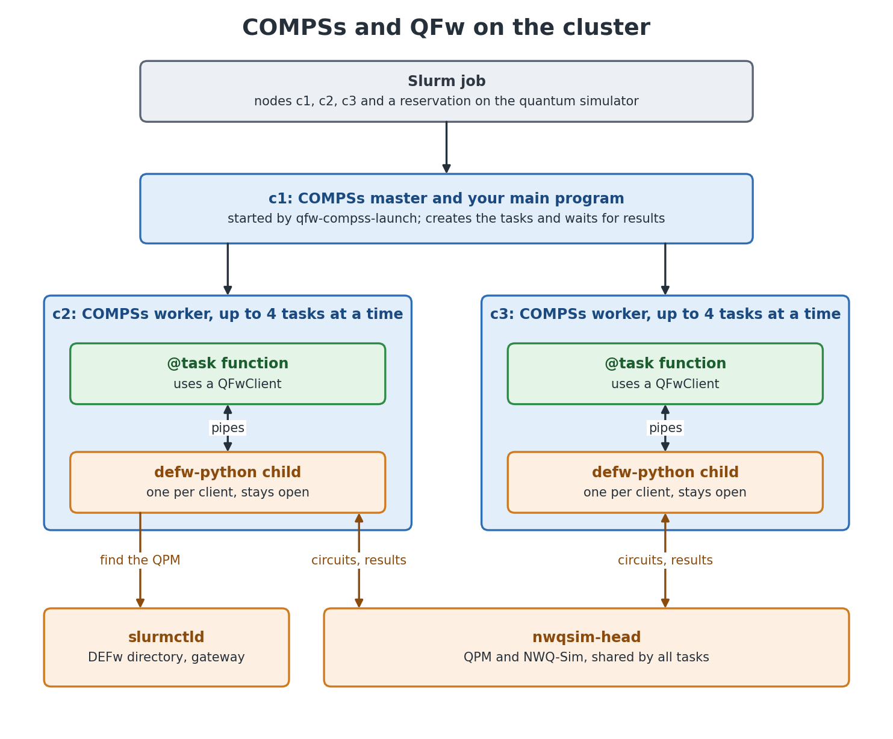
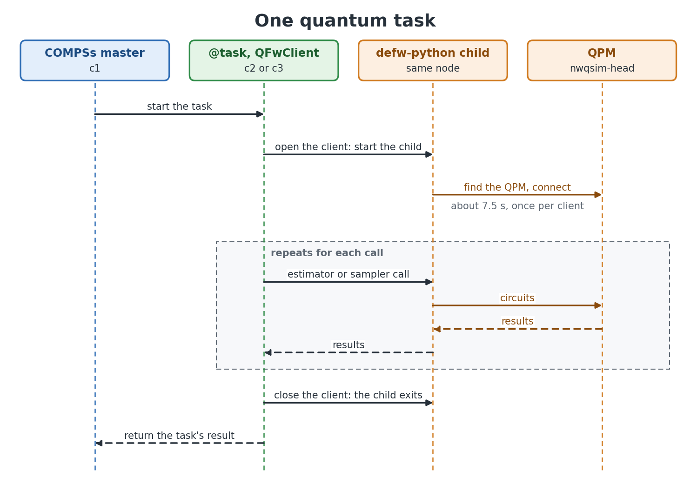

# Running COMPSs Applications on QFw

[COMPSs](https://compss.bsc.es) runs a Python program in parallel. You mark
ordinary functions with `@task`, call them as usual, and COMPSs runs them across
the cluster at the same time, starting each one when its inputs are ready.

[QFw](https://github.com/openQSE/QFw) gives a program access to quantum
simulators and hardware.

This directory joins the two: a COMPSs task can send circuits to QFw like any
Qiskit program, so many quantum tasks can run side by side.

## Try it in a few minutes

You need Docker, with at least 4 CPUs and 6 GB of memory available to it.

**1. Build the cluster image with COMPSs.** This only has to be done once, and
can take a while. Use `--slim` on a machine with no prebuilt image, such as an
Apple silicon laptop:

```bash
./do_configure.sh --slim --with-compss --image-tag rocky10.1-compss
./do_build.sh
```

**2. Start the cluster** and the QFw services:

```bash
./compss/setup-local.sh
```

**3. Run the example:**

```bash
./compss/run-local.sh hello
```

After about 30 seconds you should see something like this:

```text
angle  measured  expected  node
 0.00     0.000     0.000  c2
 0.45     0.046     0.050  c2
 0.90     0.179     0.188  c2
 1.35     0.382     0.389  c2
 1.80     0.590     0.611  c3
 2.24     0.801     0.812  c3
 2.69     0.946     0.950  c3
 3.14     1.000     1.000  c3
8 tasks finished in 15 s; the slowest took 9 s
```

Each row is one task. It rotated a qubit by that angle, sent the circuit to a
quantum simulator through QFw, and measured how often the qubit read 1. The
`measured` column should be close to `expected`, the value from theory. The tasks
ran at the same time on two nodes, `c2` and `c3`. They finish in about 15 seconds
rather than the 60 they take one at a time, because most of each task is opening its
connection to QFw, and that part can happen side by side.

## What just happened



## Write your own application

[`hello/hello.py`](hello/hello.py) is a good place to start. There are three
parts.

**A task** is a normal function with `@task`. To use a quantum device from it,
open a `QFwClient` and use its Qiskit sampler or estimator:

```python
@task(returns=1)
def measure(angle):
    circuit = QuantumCircuit(1)
    circuit.ry(angle, 0)
    circuit.measure_all()

    with QFwClient(provider="nwqsim") as qfw:
        result = qfw.sampler(default_shots=1024).run([circuit]).result()

    return result[0].data.meas.get_counts()
```

**The main program** calls the tasks, then waits for their results. Each call
returns straight away with a placeholder, and `compss_wait_on` gives you the real
values:

```python
futures = [measure(angle) for angle in angles]
results = compss_wait_on(futures)
```

**A batch script** reserves the resources and starts everything. Copy
[`hello/hello.sbatch`](hello/hello.sbatch), then change the application path and
these lines to cover everything your whole job will send:

```bash
#SBATCH --qpu=nwqsim         # which quantum device
#SBATCH --circ-count=16      # how many circuits in total
#SBATCH --max-qubits=1       # the largest circuit
#SBATCH --max-depth=16
#SBATCH --max-shots=1024
```

Its last line starts the application with `qfw-compss-launch`, not with COMPSs'
usual `runcompss` or `enqueue_compss`.

To run it, put your files under `shared-dir`, which all the nodes can see as
`/workspace/qfw-container-base`, and submit the script as a test user:

```bash
./do_ssh.sh --user user-a
sbatch /workspace/qfw-container-base/my-app/my-app.sbatch
```

### Three things to remember

1. **Open one `QFwClient` per task, not one per call.** Opening it takes about 7.5
   seconds, and after that calls are quick. An optimisation loop can make hundreds
   of calls through the same client.
2. **Import PySCF, OpenFermion and anything else that loads `h5py` inside your
   tasks, not at the top of the file.** The top of the file also runs in the
   main program, and with `h5py` loaded there, a failed task leaves the whole job
   stuck until its time limit.
3. **Let `QFwClient` find its own connection details.** Don't pass a `QFwSession`
   to a task: COMPSs would save it to its working files, and it can contain
   tokens.

## See what your job did

| What | How | Where |
| --- | --- | --- |
| **Task graph**, a picture of the tasks and how they connect | `--launch-option=--graph=true` on `qfw-compss-launch` (on in the examples) | `complete_graph.dot`, printed by `run-local.sh`. Draw it with [Graphviz](https://graphviz.org): `dot -Tpng complete_graph.dot -o graph.png` |
| **Task summary**, how many tasks ran on each node | `--launch-option=--summary` (on in the examples) | At the end of the job's output |
| **Dashboards**, with each quantum job's timings | Add `--telemetry` to `do_configure.sh`, then run `./do_startup.sh`. See the [telemetry guide](../telemetry/README.md) | Grafana, at http://localhost:3000 |

### Record a Paraver trace

A trace is a detailed timeline of what every task and thread did, which you can open
in [Paraver](https://tools.bsc.es/paraver). It needs Extrae, so build the image with
`--with-compss-tracing` instead of `--with-compss`, then run:

```bash
./compss/run-local.sh hello --trace
```

It prints where `trace.prv` is. In your own batch script, add `--tracing` to
`qfw-compss-launch`. In Paraver, load the trace and then
`/opt/COMPSs/Dependencies/paraver/cfgs/compss_tasks.cfg`, copied out of the container,
to see the tasks.

The trace covers COMPSs' tasks and runtime. It does not look inside a task's QFw child
or the simulator, so time waiting for the simulator is part of the task's bar. Tracing
adds some overhead, so don't use traced runs to compare speeds, and if a job hits the
shutdown bug below, its trace is lost.

## Examples

| Example | What it shows | Time |
| --- | --- | --- |
| [`hello`](hello/hello.py) | The basics: eight small quantum tasks in parallel | About 30 s |
| [`chemistry`](chemistry/README.md) | A real application: the energy of a helium cluster, using 20 tasks | 10 to 13 min |

## If something goes wrong

| What you see | What to do |
| --- | --- |
| The job fails | `run-local.sh` shows the end of the job's output. There is more under `~/.qfw-compss/<job>-<time>/`, which on your computer is in `shared-dir/home/user-a`: COMPSs' logs are in `.COMPSs/<job>/`, and a failed QFw connection keeps its logs in `qfw/clients/` |
| The results printed, but the job stays `RUNNING` | A COMPSs 3.4 bug when it shuts down, seen in about 1 run in 20. The log shows a `NullPointerException` in `shutdownNotification`. Your results are fine. Cancel the job with `docker exec slurmctld scancel <job>`. `run-local.sh` clears anything left behind before its next run |
| Everything stops or takes far too long | If your computer goes to sleep, Docker freezes too, and jobs can pass their time limit. Keep it awake during a run |
| `The image has no COMPSs` | The configured image was built without it. Build it with `--with-compss` (step 1). If you have only just built it, a running cluster moves to it when you run `setup-local.sh` again, unless jobs are running |
| Every task fails with `no QPM circuit results were received` | The simulator is stuck. Restart it with `docker exec slurmctld qfw-site-services stop --target nwqsim`, then `start --target nwqsim`, and run the job again |

## What has been tested

These examples have run on the site NWQ-Sim simulator, on a slim arm64 image on an
Apple silicon laptop with Docker limited to 4 CPUs and 6 GB of memory, and on a full
arm64 image built with `Dockerfile.compss`. Tracing has only run on the slim image.
amd64 and the other quantum devices have not been tested.

<details>
<summary>How it works inside</summary>

### The pieces

| Path | Role |
| --- | --- |
| `qfw_compss/client.py` | `QFwClient`, with Qiskit `BaseEstimatorV2` and `BaseSamplerV2` front ends. Works from any Python process. |
| `qfw_compss/_server.py` | The child process. Runs `QFwBackend`, `QFwEstimatorV2` and `QFwSamplerV2`. |
| `qfw_compss/session.py` | `QFwSession`: the environment `qfw-srun` gives an application, captured once per job. |
| `qfw_compss/launch.py` | `qfw-compss-launch`: captures the session and runs `launch_compss` inside the allocation. |
| `qfw-cluster.cfg` | COMPSs' configuration for these containers: Slurm, 4 CPUs, 6 GB, workers started by `srun`. |
| `tests/` | Tests that need Qiskit, but neither QFw nor COMPSs. |
| `diagrams/` | The diagrams on this page. `make_diagrams.py` redraws them. |

### Why each client has a child process



QFw's client needs the DEFw runtime, which `defw-python` provides: Python embedded
in a native process with its own RPC listener threads. A COMPSs worker forks its
executors from an ordinary interpreter, and a forked child loses those threads. So
each `QFwClient` starts one `defw-python` child, with its own DEFw identity, and
talks to it over a pair of pipes. A failed primitive call raises `QFwError` and
leaves the client usable. `call_timeout` bounds each call; by default a call waits
as long as QFw does.

A task does not run under `qfw-srun`, because a COMPSs worker starts it. So
`qfw-compss-launch` runs a small script under `qfw-srun` once, before COMPSs
starts, and saves the environment that script sees. Tasks find the file through
`$QFW_COMPSS_SESSION`. The launcher deletes it when the application ends, because
the environment can hold tokens.

### Why not `enqueue_compss`

`enqueue_compss` writes its own batch script, which leaves no room for the `--qpu`
options or for `qfw-setup` and `qfw-teardown`. `qfw-compss-launch` runs the part of
that script that matters from a batch script you write. Workers start through
`srun`, so they inherit the job's environment and need no SSH setup.

### Adding COMPSs to an existing image

```bash
docker build -f Dockerfile.compss \
  --build-arg BASE_IMAGE=ghcr.io/openqse/qfw-slurm-cluster:<tag> \
  -t qfw-slurm-cluster:<tag>-compss .
```

Both this and `--with-compss` install COMPSs from the release tarball, without
the C binding, Kafka or the monitor, and without tracing unless you ask for it: add
`--build-arg QFW_WITH_COMPSS_TRACING=1` here, or use `--with-compss-tracing`. COMPSs'
Python binding is built against the Python that the QFw venv and `defw-python` use.

The tarball comes from compss.bsc.es and must match the SHA-256 pinned in
`tools/install-compss.sh`. To build from a copy of it instead, such as on a host
without internet access, set `COMPSS_URL`: `COMPSS_URL=<url> ./do_build.sh`, or
`--build-arg COMPSS_URL=<url>` here.

### The reservation

`--circ-count`, `--max-qubits`, `--max-depth` and `--max-shots` form one envelope
for the allocation, and COMPSs never sees it. Whether a QPM enforces it depends on
its admission policy. The site NWQ-Sim QPM here admits with an unlimited policy;
under an enforcing one, a task that goes past the envelope fails rather than waits.

### Container-specific settings

- `qfw-compss-launch` passes `--cpu_affinity=disabled`. With automatic binding, the
  NIO worker exits with status 0 right after creating its CPU binder inside these
  containers, and the master only reports "connection refused".
- It picks the master's port below 32768. `launch_compss` defaults to 43000-44000,
  inside Linux's ephemeral range, so another socket on the node can take the port
  first, and the master then hangs with `Address already in use`.
- `qfw-cluster.cfg` adds the keys COMPSs' `default.cfg` lacks, such as
  `DEFAULT_FPGAS_PER_NODE`. `launch_compss` passes them unquoted into the worker
  command line, so one missing key makes the worker reject its arguments.
- Worker steps use `srun --overlap --mem=0`, so they share the job's CPUs with the
  batch step instead of waiting for them.

### Why a failed task can hang the master with `h5py` loaded

The JVM calls `exit()`, HDF5's exit handler waits for the GIL, and the main thread
holds the GIL inside a COMPSs call that is waiting for the JVM.

### Running the tests

From `QFw-SLURM-Cluster`, with any Python that has Qiskit:

```bash
python3 -m unittest discover -s compss/tests -v
```

A stub `qfw_qiskit` and a `defw-python` shim stand in for QFw.

</details>
