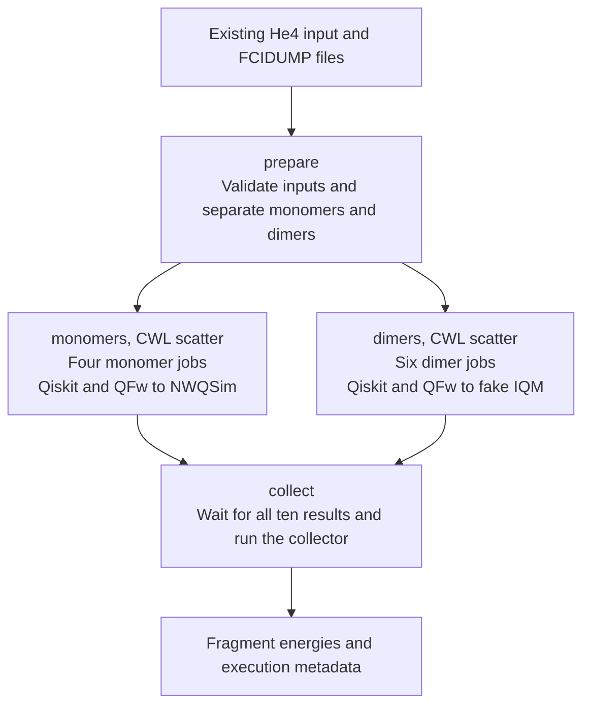

# FMO-VQE Workflow with StreamFlow

This example runs the four He4 monomers through NWQSim and the six dimers
through fake IQM, then collects energy and execution metadata for each fragment.

## Run locally

Start Docker and keep `chemistry_he` next to `QFw-SLURM-Cluster`. The virtual
cluster image must already be available. From `QFw-SLURM-Cluster`, run:

```sh
./streamflow/chemistry/setup-local.sh
./streamflow/chemistry/run-local.sh
```

`setup-local.sh` prepares the Docker testbed. It starts the cluster if needed,
starts NWQSim and fake IQM services, copies the workflow and installs StreamFlow
0.2.0rc3 in a separate environment. The application checkout is copied only when
the shared copy does not exist. Run setup once initially and again after changing
workflow files or requirements.

`run-local.sh` starts one calculation using that installed copy. It creates a
separate run directory, invokes `run.py` as the application user inside
`slurmctld`, saves the log and reports failures. These scripts are local helpers;
StreamFlow's native Slurm connector submits the jobs.

The launcher prints the run directory. It contains `streamflow.log`, the resolved
configuration, `summary.json` and the collected outputs. The summary lists each
fragment's backend, Slurm job ID, compute node and QFw reservation.
`workflow-results.json` contains the individual fragment results. `CHEMISTRY_RUN_ID` can give the run a recognisable directory name.

## Workflow



Preparation separates fragments by type: four monomers and six dimers.
Each fragment becomes one Slurm job. The two scatters share a limit of four
outstanding jobs across the deployment. Slurm chooses their compute nodes but you can also use a specific node by declaring it on the `streamflow.yml`.
QFw sends circuits to the backend selected for each step in `streamflow.yml`.
Preparation, optimization and collection run on classical compute nodes.

## What runs where

| Step | Compute node | Work |
| --- | --- | --- |
| Prepare | Available node in `normal` | Validate the input and fragment set, check fragments against the full FCIDUMP and separate monomers and dimers |
| Monomers | Available node in `normal` per fragment | Calculate four monomers through QFw/NWQSim |
| Dimers | Available node in `normal` per fragment | Calculate six dimers through QFw/fake IQM |
| Collect | Available node in `normal` | Check results and provenance, run the collector and gather fragment results |

There are ten separate chemistry jobs;
`maxConcurrentJobs: 4` limits outstanding jobs across all stages, including jobs
pending in Slurm. Slurm selects available nodes from `normal`; no stage has a
fixed node list. The coordinator runs inside
`slurmctld` and uses local Slurm commands through StreamFlow's native connector.

Qiskit and the optimizer run on the allocated compute node. Inside the allocation, `qfw-setup`, `qfw-srun`
and `qfw-teardown` manage the application runtime. QFw sends the circuits to the
reserved provider. The provider service runs on its dedicated service node, such
as `nwqsim-head`; `qfw-slurm` owns reservation and release. A service node listed
as `idle` by `sinfo` does not prove that its quantum endpoint is operational.

This follows the allocation contract in the
[Workflow Manager Integration Guide](https://github.com/openQSE/qfw-slurm/blob/main/docs/workflow-manager-integration.md)
and the service topology in [Design Overview](../../README.md#design-overview). `--qpu` belongs on
`sbatch`, alongside the circuit, qubit, depth and shot bounds. It is not repeated
on `qfw-srun`.

## Select a quantum backend

`cwl/workflow.cwl` defines dependencies and the monomer and dimer scatters.
`streamflow.yml` binds each scatter to a Slurm service and defines all
its resources: Slurm selects the application node from `partition: normal`,
while `qfw.qpu` selects the public quantum resource. The runner derives the QFw provider from that selection;
there is no backend launcher option.

| StreamFlow service | Public `--qpu` | QPM service | Application provider | Status |
| --- | --- | --- | --- | --- |
| `chemistry-nwqsim` | `nwqsim` | `nwqsim` | `nwqsim` | Default simulator |
| `chemistry-fake-iqm` | `fake-iqm-20q` | `fake-iqm` | `fake-iqm` | Synthetic integration test |

The default bindings are:

```yaml
- step: /monomers
  target: {deployment: slurm, service: chemistry-nwqsim, locations: 1}
- step: /dimers
  target: {deployment: slurm, service: chemistry-fake-iqm, locations: 1}
```

To run all ten fragments on NWQSim, change `/dimers` to
`service: chemistry-nwqsim`. To use fake IQM for every fragment, change `/monomers`
to `service: chemistry-fake-iqm`. Run setup and launch again after editing the bindings. To use IQM hardware,
set `qfw.qpu: ornl-iqm-20q` on the selected service only after the site administrator has enabled the IQM QPM,
configured valid credentials and confirmed the endpoint, permissions and workload
bounds. Setup does not start IQM or submit hardware jobs. The IQM resource's provider
mapping and reservation validation are unit tested; hardware execution is not.

Standard Slurm options use the connector's native YAML fields. The launcher
turns the inline `qfw` options into temporary shell templates in the run directory
because rc3 has no native fields for the QFw Slurm plugin. That launcher-only
section is removed before StreamFlow validates the resolved configuration.
Single-node jobs use Slurm's defaults of one task and one CPU per task.
The existing application wrapper activates QFw when needed.

`locations: 1` requests one Slurm allocation per scattered job. It does not mean
one quantum processor or one fragment for the entire workflow. `local.yml` contains
the shared root and optimizer limits. `cases.yml` lists the inputs:
the ten fragment files belong to one He4 case, not ten separate molecular cases.

`fragment.py` calls the unchanged application's calculation and QFw lifecycle
functions. `fragment.sh` starts and tears down the runtime for each fragment.
The original chemistry batch script runs the whole case with one provider, which
is why fragment execution needs this adapter. The final stage reuses
`chemistry_he/workflow/slurm/collect-results.sbatch`.

## Tests

After setup, run the unit tests inside the controller:

```sh
docker exec --user user-a \
  --env CHEMISTRY_TEST_SOURCE=/workspace/qfw-container-base/chemistry_he \
  slurmctld \
  /workspace/qfw-container-base/streamflow-chemistry/venv-0.2.0rc3/bin/python \
  -m unittest discover -v \
  -s /workspace/qfw-container-base/streamflow-chemistry/tests
```

They check backend bindings, resource bounds, complete fragment sets, unchanged
input bytes, reservation validation, failed application scripts, result writing
before QFw shutdown, invalid energies and missing, duplicate or modified results.
They also verify the four-monomer/six-dimer split, backend routing, collected
fragment results and labels for simulation and synthetic runs. The four Docker failure tests are skipped by this command.

Run those four tests using Python 3 on the Docker host, from `QFw-SLURM-Cluster`:

```sh
CHEMISTRY_TEST_DOCKER=1 python3 -m unittest discover -v \
  -s streamflow/chemistry/tests -p test_streamflow.py
```

These submit real StreamFlow/Slurm jobs with isolated application fixtures. They
cover rejected submission, invalid preparation input, failed chemistry and failed
collection, checking error propagation, blocked downstream execution and released
quantum reservations. They do not run the scientific solver. Fixtures and logs
are retained in the host-created `shared-dir/streamflow-chemistry/tests/failure-*`
directories.

`run-local.sh` is the positive end-to-end test. It uses the scientific application
functions on all ten supplied fragments, with classical preparation and collection.
Hardware execution is not covered by these tests.
