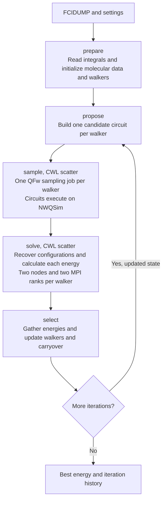

# SQD with StreamFlow

A small closed-loop SQD workflow using StreamFlow 0.2.0rc3 and its native Slurm
connector. The default case is H2 in STO-3G: four qubits, four walkers, two
iterations and 1024 shots per circuit. Sampling goes through QFw to NWQSim;
configuration recovery and SBD diagonalization run on classical compute nodes.
The H2 FCIDUMP is copied unchanged from the
[upstream cluster recipe](https://github.com/qiskit-community/qcsc-prefect/blob/95385887afe0ee6e4c02598e4ab74909574315b7/algorithms/sbd/data/fcidump_H2_STO3G.txt).

The scientific stages follow the
[IBM SQD example](https://github.com/qiskit-community/qcsc-prefect/tree/96fed8eed8aa00966342951ec1e9957d5f40fd80/algorithms/sbd).
This implementation uses PySCF, ffsim, qiskit-addon-sqd and the same native SBD
solver.

## Run

The Docker cluster must be running and provisioned, with the non-root `user-a`
account. From the QFw-SLURM-Cluster repository:

```sh
./streamflow/sqd/setup-local.sh
./streamflow/sqd/run-local.sh
```

For a larger example with eight walkers:

```sh
./streamflow/sqd/run-local.sh inputs-h4.yml
```

This uses a linear H4 chain with 1 Angstrom spacing in STO-3G: four electrons,
four spatial orbitals, eight qubits and two iterations. `settings-h4.json` sets
eight walkers and a subspace dimension limit of 36. It is a small model system
for checking the workflow and comparing with an exact calculation.

`setup-local.sh` copies the workflow into the shared `streamflow-sqd` directory
and installs separate environments for the coordinator and scientific application.
It builds SBD from the pinned upstream source if needed and starts the NWQSim
service plane. On ARM, it rebuilds ffsim if the wheel is incompatible with the CPU.
The image's QFw environment is kept separate. Run setup once initially and again
after editing workflow files or requirements.

`run-local.sh` selects the input YAML, creates a separate run directory and
invokes `run.py` as the application user inside `slurmctld`, saving the execution
log and reporting failures. These scripts are local helpers; StreamFlow's native
Slurm connector submits the jobs. Setup is not part of every SQD iteration.

The launcher prints the run directory. To read the result or follow its log:

```sh
docker exec --user user-a slurmctld cat <run-directory>/output/state.json
docker exec --user user-a slurmctld tail -f <run-directory>/streamflow.log
```

`SQD_RUN_ID=my-run ./streamflow/sqd/run-local.sh` assigns a run name. Every run
has a separate configuration, database, working directory and output. Logs are
written inside the container as the application user, including on Linux hosts.

## Workflow



The feedback arrow shows the dependency between iterations. The coordinator
expands the configured iteration count into a standard CWL 1.2 graph. Each
iteration consumes the previous iteration's state. StreamFlow owns task execution,
scatter and file movement.

| Stage | Slurm allocation | Work |
| --- | --- | --- |
| Prepare, propose, select | One available node in `normal` | Molecular data, LUCJ circuits and differential-evolution updates |
| Sample | One available node in `normal` per walker | One QFw client per walker; circuits execute through the NWQSim QPM |
| Solve | Two available nodes in `normal` per walker | SQD configuration recovery and SBD with one MPI rank per node |

The local `normal` partition contains `c1` through `c8`. No stage has a fixed
node list: Slurm places jobs on available nodes. The deployment allows up to four
outstanding jobs across all stages, including jobs pending in Slurm. Four sampling
jobs use up to four nodes; four SBD jobs need eight nodes. With eight walkers,
remaining work waits until a slot becomes free.

`maxConcurrentJobs: 4` bounds concurrent Slurm submissions. Each SBD job requests
two nodes and two tasks, with one task per node. `mpirun --map-by ppr:1:node`
places one MPI process on each allocated node. Both processes cooperate on one
walker's energy. This preset parallelizes Hamiltonian operations; the alpha and
beta determinant communicator sizes remain one. Larger runs that also distribute
wavefunction storage need the corresponding SBD communicator settings.
SBD uses `mpirun` within its Slurm allocation;
the local image's Slurm has `MpiDefault=none`, so direct `srun` does not establish
the OpenMPI process group.

Quantum reservations follow the
[Workflow Manager Integration Guide](https://github.com/openQSE/qfw-slurm/blob/main/docs/workflow-manager-integration.md).
Only the sampling allocation carries `--qpu` and the circuit bounds. Its runtime
uses `qfw-setup`, `qfw-srun` and `qfw-teardown`, reusing `prefect/qfw_sampler.py`
as a standalone application. qfw-slurm owns reservation and release.

## Inputs and outputs

Edit the selected settings file for walkers, iterations, shots, subspace
dimension and seed. `inputs.yml` selects H2 and `inputs-h4.yml` selects H4.
The differential-evolution strategy is best/2/bin, with scaling factor 0.6,
crossover probability 0.9 and one LUCJ layer. At least four walkers are required.
The subspace dimension bounds the product of the alpha and beta determinant sets.
Initialization follows the upstream LUCJ construction: decompose with an extra
repetition, retain the requested layer and use the last orbital rotation as the
final rotation. This is different from directly requesting a one-repetition
operator. The H2 circuit probabilities are covered by a regression test against
the upstream construction.

`settings.json` also sets the upstream fast SBD preset: `block=4`, `iteration=1`,
`tolerance=0.01` and `carryover_ratio=0.1`. These are solver parameters.
`iterations=2` controls the outer workflow and checks feedback between generations.
The solver iteration count controls Davidson restarts; its tolerance applies to
the residual norm, not an accepted error in the molecular energy. The effective
block is capped at the selected subspace size and is recorded in each result's
`solver_settings`. The optional H4 profile keeps its tighter solver settings.

`inputs.yml` identifies the FCIDUMP, settings, sampler and SBD binary. The example
supports closed-shell inputs with converged RHF and CCSD initialization. For a
larger molecule, also adjust the quantum bounds and classical resources before
running. The sampling template allows up to eight qubits and 4096 shots per
circuit. The N2 example from upstream needs more qubits than this preset.
Real hardware execution is not validated here.

`streamflow.yml` contains the three Slurm services: account, partition,
node placement, MPI task counts and time limits. Edit its
`quantum.qfw` section to select the QPU and circuit bounds. The coordinator uses local
Slurm commands in `slurmctld`; no SSH deployment is needed for this testbed.
Site paths in the scripts and templates must be adapted before a Janus deployment.

Standard Slurm options use the connector's native YAML fields. Single-node
jobs use Slurm's defaults of one task and one CPU per task. MPI explicitly
requests two nodes and two tasks, with one task per node. CWL sets the numerical
libraries to one thread and invokes the application Python directly. Only
`sample.sh` activates the QFw SDK, for the quantum client.

The launcher converts the `qfw` section into a temporary submission template
inside each run directory because rc3 has no native fields for the QFw Slurm
plugin.

The final `state.json` contains the best energy, population, carryover and a
history of every walker. Each evaluation records the circuit hash, shots, input
carryover, output carryover, provider and Slurm job IDs. Intermediate circuits,
counts, SBD input/output and solver logs remain in the run's `work` directory.
The declared CWL files and directories connect the stages. This local test uses
a shared filesystem and does not validate transfers between separate sites.

There are three CWL files: `workflow.cwl` is the iteration template,
`iteration.cwl` connects one generation, and `tools.cwl` defines the five tools.
`sqd.py` implements those tool entry points. `run.py` resolves inputs and renders
the requested number of iterations; `run-local.sh` only launches it in Docker.

## PySCF references

Reference energies are local calculation results, stored alongside the inputs:

- `data/h2.reference.json`: upstream H2/STO-3G at 0.74 Angstrom, FCI energy
  -1.1372838344885006 Hartree.
- `data/h4.reference.json`: the linear H4/STO-3G chain described above.

Each file records the molecular model, input checksum, PySCF version and total
FCI energy, including the constant contribution in the FCIDUMP. FCI is exact
within that orbital basis. It does not remove the error from choosing a small
basis or an approximate molecular model.

After a run, compare its best energy against PySCF using the same input:

```sh
docker exec --user user-a --env OMP_NUM_THREADS=1 slurmctld \
  /workspace/qfw-container-base/streamflow-sqd/application/bin/python \
  /workspace/qfw-container-base/streamflow-sqd/reference.py \
  /workspace/qfw-container-base/streamflow-sqd/data/h4.FCIDUMP \
  <run-directory>/output/state.json
```

The JSON output contains both energies, their absolute difference in Hartree
and a check at 1e-8 Hartree. It verifies the input checksum recorded in
`state.json` so that results from different molecules cannot be compared by
mistake. Omitting the final argument computes only the FCI reference.
This utility is separate from the workflow and supports small closed-shell
problems with at most 100000 determinants.
The H4 run may sample a smaller subspace than the 36-determinant limit. Check
the reported error to assess scientific convergence after the jobs complete.
H2 is an integration test. Successful jobs and finite energies do not establish
scientific convergence. Report the measured energy error rather than requiring
an exact match from the fast preset. The 1e-8 comparison is a diagnostic, not
the pass criterion for that preset. No project-approved energy-error threshold
has been established here. Classical seeds do not fix simulator measurement
randomness, so repeated runs may select different subspaces.

For another molecule, generate its FCIDUMP with PySCF's `fcidump.from_scf`,
create an input YAML pointing to it and to its settings, and check the quantum
qubit/depth/shot bounds before submission. All input paths are resolved relative
to the selected YAML file. The CWL workflow is shared by all cases.

## Tests

After setup, run configuration tests in the coordinator environment and scientific
tests in the application environment:

```sh
docker exec --user user-a slurmctld \
  /workspace/qfw-container-base/streamflow-sqd/coordinator/bin/python \
  -m unittest discover -v \
  -s /workspace/qfw-container-base/streamflow-sqd/tests -p test_configuration.py

docker exec --user user-a \
  --env OMP_NUM_THREADS=1 --env OPENBLAS_NUM_THREADS=1 --env MKL_NUM_THREADS=1 \
  slurmctld /workspace/qfw-container-base/streamflow-sqd/application/bin/python \
  -m unittest discover -v \
  -s /workspace/qfw-container-base/streamflow-sqd/tests -p 'test_[sr]*.py'
```

These check parameter bounds, reproducible mutation, selection and carryover,
count validation, reservation checks, circuit integrity, H2 preparation, QPY
serialization, iteration dependencies, alternative inputs, FCI references and
Slurm bindings.

Run the Slurm integration tests from the Docker host, with all eight compute
nodes available:

```sh
SQD_TEST_DOCKER=1 python3 -m unittest discover -v \
  -s streamflow/sqd/tests -p test_docker.py
```

The two failure tests submit real StreamFlow/Slurm jobs using isolated copies
of the workflow. Invalid input must block sampling. A failed sampling allocation
must block SBD and release its QFw reservation. Their logs remain under
`streamflow-sqd/tests/failure-*` in the shared directory.

The numerical control uses fixed configurations spanning the full H2 basis.
It runs preparation and two-node MPI SBD through StreamFlow with a tighter
solver tolerance, then compares the total energy with PySCF FCI at 1e-8 Hartree.
It tests the classical numerical path independently of quantum sampling; its
counts are an explicit fixture and do not come from QFw.

The two positive tests launch H2 with four walkers and H4 with eight walkers
through `run-local.sh`. They check concurrent sampling on distinct nodes,
the four-job window across stages, two-node SBD allocations, successful completion
and quantum reservation release.
Their logs remain under `streamflow-sqd/runs/parallel-*`. H2 submits 21 jobs,
including eight quantum jobs and eight MPI solver jobs. H4 submits 37 jobs,
including sixteen quantum jobs and sixteen MPI solver jobs. Both cases
exercise the population and carryover feedback paths.
The positive tests also check that every solver result records the settings
used for that selected subspace.
